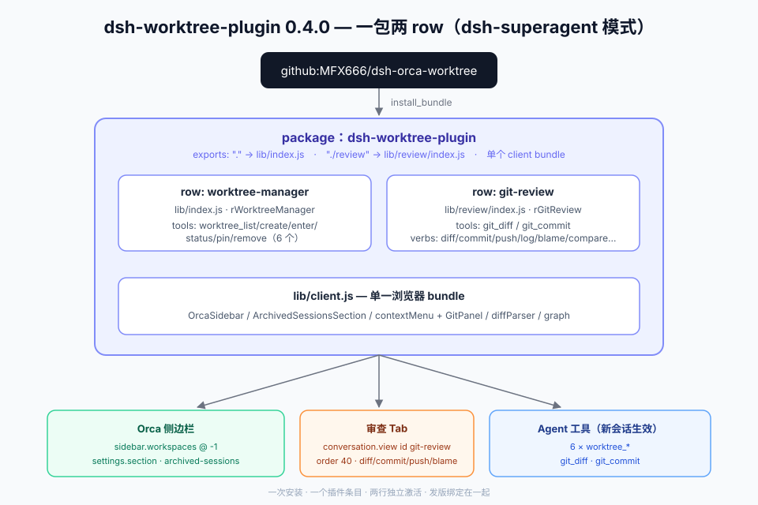

# dsh-worktree-plugin

DeepSeek Harness 单包双 row 插件（dsh-superagent 模式）：**Git 工作树侧边栏** + **Git 审查面板**，一次安装、一个插件条目、两行独立激活。



## Row 1：worktree-manager — Git 工作树侧边栏

Orca 风格 Git Worktree 与对话侧边栏（`rWorktreeManager`）：

1. **左栏树 1:1 还原（`sidebar.workspaces` `priority: -1`）**：
   - 顶层项目组：`📁 仓库名` + hover `⌄` 折叠、`•••` 菜单、`+` 新建工作树。
   - 工作树分支行：左侧状态绿点（运行中呼吸、待确认黄点、空闲常绿）+ 分支名 + 右侧黄色 `★` 星标置顶。
   - 子工作树谱系胶囊：`[ ⑂ N | ● 运行数 ● 就绪数 ⌄ ]`，点击折叠/展开 `18px` 步进缩进的子工作树；谱系 = 注册表 `parentPath`，缺失时按物理路径嵌套自动推导（树可以有子树），移除父树时物理子树同样阻断。
   - Worktree 下直接对话：点击分支自动进入/创建绑定在该 worktree 目录下的独立对话（Session），支持展开同一 worktree 下的多条历史对话或点 `+` 新建多对话；对话行不带绿点——运行中显示 loading 转圈、等待确认显示黄点、结束时与原生 DSH 样式一致（无标记）。
   - 非 Git 文件夹工作区与未分组会话自动兜底保留，不丢任何历史会话；支持工作区重命名与移除（含本地目录已丢失的悬空工作区标记与一键移除）。
   - **按分支归档与设置页恢复（`设置 → 已归档会话`）**：删除工作树时，自动调用 DSH 官方 `workspaceRegistry.archiveSession` 将该分支下的对话归档，并在设置页左侧导航挂载 `已归档会话`（按 `Git 仓库 → Git 分支 → 会话` 层级分组，支持搜索、单条/整分支取消归档与一键恢复打开，与原生归档状态 100% 互通）。
2. **Host 远程服务与持久化工作树池**：
   - 默认工作树池位于 `~/.dsh/dsh-orca-worktrees/<repo-key>/<branch>`（可通过 `DSH_WORKTREE_POOL` 覆盖），独立于插件 `lib/` 构建目录，`pnpm build` 不会误删已有检出。
   - `overview(includeDirty?)`、`archivedMeta()`、`branches(repositoryRoot, refresh?)`、`create(repositoryRoot, name?, from?, parentPath?)`、`ensureWorkspace(path, title?)`、`setPinned(path, pinned)`、`remove(path, force?, deleteRemote?)`、`status(path)`。
   - 全部浏览器接口与当前是否打开 Session 解耦（无 `agent` 查找参数），新建 worktree 自动同步注册到宿主 `workspaceRegistry` 并持久化 `branch.<name>.base` 与谱系元数据。
3. **Agent 工具**：`worktree_list`、`worktree_create`、`worktree_enter`、`worktree_status`、`worktree_pin`、`worktree_remove`。

## Row 2：git-review — Git 审查面板

会话视图「审查」Tab（`conversation.view` id `git-review`，`rGitReview`），对任意 git 检出路径工作：

- **Diff 审查**：staged / unstaged / untracked 分组，逐文件 unified/split 视图，行内词级高亮；按文件/目录过滤与搜索。
- **分块提交**：勾选 hunk 暂存（`applyPatch` 管线），staged 预览后一次提交；支持文件级一键暂存/取消。
- **历史与对比**：提交图（lane 布局，HEAD 最左，无幽灵 lane）、单提交详情、分支 compare、`blame` 逐行归属。
- **AI 提交信息**：`suggestCommitMessage` 按暂存内容生成提交信息。
- **Push**：推送当前分支到 upstream。
- **Agent 工具**：`git_diff`、`git_commit`。
- 行图标与列表元数据：`exports["./review/icon"]` + `exports["./review/locale/*.json"]`（host 按 `<row 模块名>/icon` 解析）。

## 安装

```bash
# DSH 插件管理器或设置 → 插件，来源填：
github:MFX666/dsh-orca-worktree
```

## 构建与自检

```bash
pnpm build   # tsc 降级装饰器 → tsdown 4 bundles（node ×2 / client / diffParser / graph）
pnpm test    # worktree e2e + git-review e2e + 纯函数单测
```

## 结构速览

```
src/index.ts            row 1 host：WorktreeManagerService（rWorktreeManager）
src/review/             row 2 host：GitReviewService（rGitReview，exports "./review"）
src/client/             row 1 浏览器半：OrcaSidebar / ArchivedSessionsSection / 右键菜单
src/client/review/      row 2 浏览器半：GitPanel / diffParser / graph（并入单一 client bundle）
cordis.patch.yml        insert 两行：worktree-manager + git-review（name 指向子路径）
icon.svg                row 1 图标；review-icon.svg + review/locale/ 为 row 2 图标与列表文案
```
